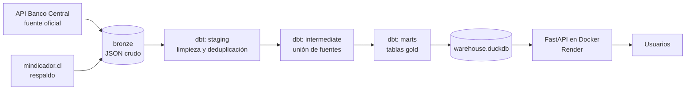
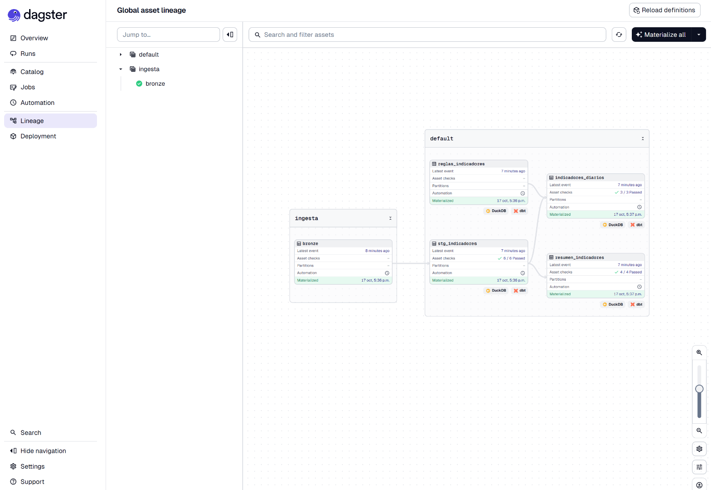
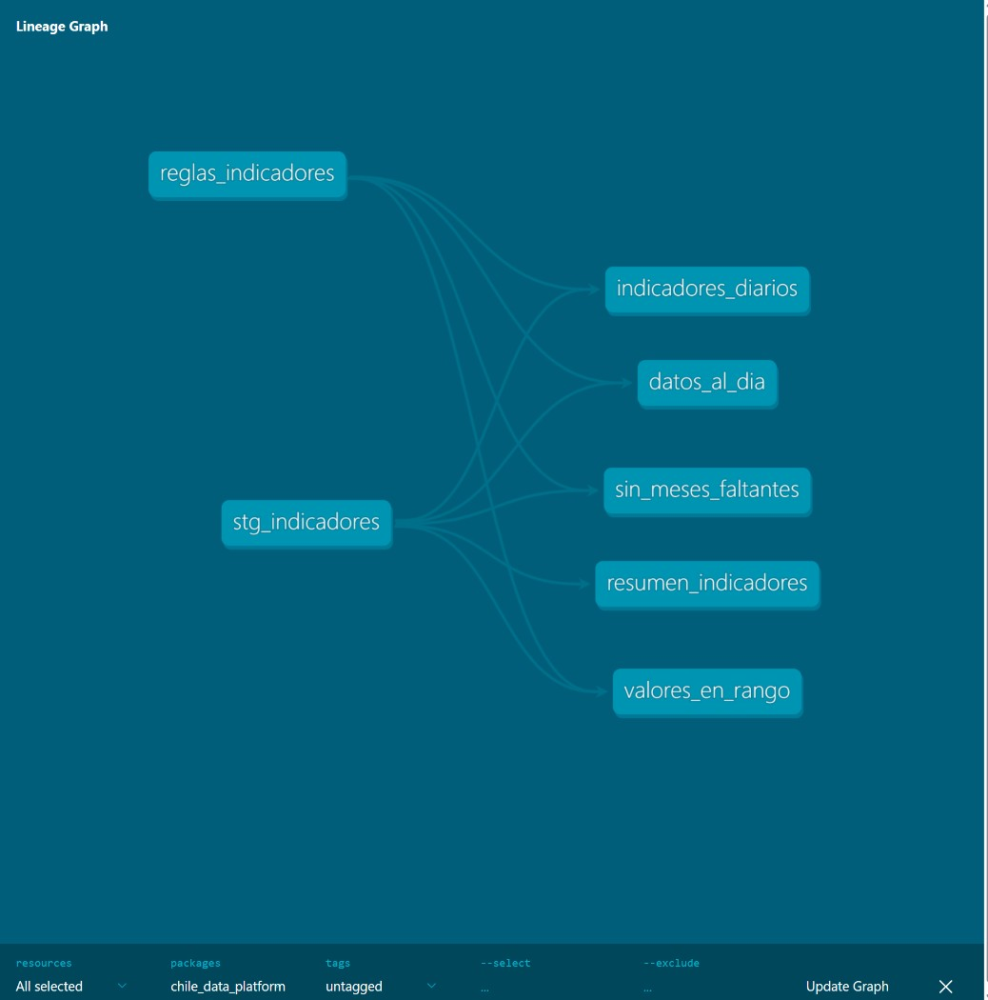

# Chile Data Platform

**Plataforma abierta de indicadores económicos de Chile: se actualiza sola cada día desde la fuente oficial, valida cada dato con pruebas automáticas y lo entrega por una API pública.**

[](https://github.com/niberdi01gold/chile-data-platform/actions/workflows/ci.yml)
[](https://github.com/niberdi01gold/chile-data-platform/actions/workflows/actualizar.yml)


### 🔗 API en vivo: **https://chile-data-platform.onrender.com/docs**

> Plan gratuito: si nadie la usó en los últimos 15 minutos, la primera consulta tarda ~1 minuto en despertar.

## Qué entrega

Nueve indicadores, con su último valor y su variación a 30 días y 12 meses:

| Diarios | Mensuales |
| --- | --- |
| Dólar observado · Euro · UF · Cobre (USD/lb) · TPM | UTM · IPC · IMACEC · Tasa de desempleo |

```bash
curl https://chile-data-platform.onrender.com/indicadores/dolar
curl "https://chile-data-platform.onrender.com/indicadores/uf/serie?desde=2026-01-01"
```

| Endpoint | Devuelve |
| --- | --- |
| `GET /salud` | Estado del servicio y fecha del dato más reciente |
| `GET /indicadores` | Último valor de los 9 indicadores con sus variaciones |
| `GET /indicadores/{codigo}` | Un indicador (`dolar`, `uf`, `ipc`, `libra_cobre`…) |
| `GET /indicadores/{codigo}/serie?desde=&hasta=` | Historia entre dos fechas (desde 2021) |

## Arquitectura



**Todo corre solo, sin un computador encendido:**

1. Cada día a las 09:50 (hora de Chile), GitHub Actions extrae los datos del Banco Central.
2. dbt construye las capas y ejecuta **27 pruebas de calidad**. **Si alguna falla, no se publica nada**: la API sigue entregando los datos del día anterior, nunca datos malos.
3. La base resultante se publica como *release* de GitHub.
4. La API (Docker en Render) descarga la base más reciente al arrancar.

En desarrollo, el mismo flujo se orquesta con **Dagster**:



## Decisiones de diseño

- **Arquitectura medallion** (bronze → silver → gold): la respuesta cruda se guarda tal cual llegó, con la fecha de extracción en el nombre del archivo. Cualquier dato se puede reconstruir.
- **Fuente oficial con respaldo.** El Banco Central es la fuente principal y mindicador.cl el respaldo. Si un indicador falta en el Banco Central, se usa mindicador.cl **para ese indicador completo**: nunca se mezclan fuentes dentro de una misma serie, porque pueden diferir en fechas de publicación.
- **Una sola fuente de verdad para la configuración.** Los códigos de series viven en `transform/seeds/series_bcch.csv`, que leen el extractor y dbt. Las reglas de calidad (frecuencia, días máximos sin datos, rango válido) viven en `reglas_indicadores.csv`.
- **Variaciones correctas según el tipo de indicador.** Los montos (dólar, UF) se comparan en %; los indicadores que ya son porcentaje (IPC, TPM, desempleo) se comparan en **puntos**: una TPM que pasa de 4,75 % a 4,50 % baja 0,25 puntos, no 5 %.
- **El IMACEC se calcula, no se copia.** El Banco Central lo entrega como índice (2018 = 100); dbt calcula la variación anual comparando cada mes con el mismo mes del año anterior.
- **La CI no depende de APIs externas.** Las pruebas usan una muestra real guardada en `tests/fixtures`, así un servicio externo caído no rompe el build.
- **API segura por diseño:** base en solo lectura y consultas parametrizadas (sin inyección SQL). Imagen Docker liviana (74 MB): solo FastAPI, Uvicorn y DuckDB.
- **Secretos fuera del código:** credenciales en `.env` (local) y GitHub Secrets (nube).

## Calidad

- **27 pruebas de datos en dbt:** unicidad, nulos, valores aceptados, relaciones, rangos por indicador, frescura según el calendario de publicación y meses faltantes.
- **9 pruebas de la API** con pytest, contra una base de prueba aislada.
- **CI en cada push:** instala todo en un Linux limpio, corre pytest, dbt build, valida Dagster y construye la imagen Docker.



## Incidentes reales

Este proyecto documenta sus fallas como lo haría un equipo en producción:

- **[IPC sin datos](docs/incidentes/2026-10-16-ipc-sin-datos.md):** la prueba de frescura detectó que mindicador.cl dejó de publicar el IPC después de diciembre de 2025. Se **midió** la latencia de las fuentes desde los servidores de GitHub (mindicador.cl 7,15 s vs. Banco Central 0,37 s) y se migró a la API oficial del Banco Central. Resuelto.

## Cómo correrlo localmente

```bash
git clone https://github.com/niberdi01gold/chile-data-platform
cd chile-data-platform
python -m venv .venv && source .venv/bin/activate   # Windows: .venv\Scripts\Activate.ps1
pip install -r requirements.txt

# Credenciales gratuitas del Banco Central: https://si3.bcentral.cl/Siete/es/Siete/API
echo "BCCH_USER=tu_correo" >> .env
echo "BCCH_PASS=tu_clave" >> .env

python src/extraer_bcch.py --desde 2021         # 1. extraer (bronze)
cd transform && dbt build --profiles-dir . && cd ..   # 2. transformar y probar
uvicorn api.main:app --reload                   # 3. API en http://127.0.0.1:8000/docs

dagster dev -f orquestacion/definitions.py      # opcional: orquestador en http://127.0.0.1:3000
```

Con Docker:

```bash
docker build -t chile-api .
docker run --rm -p 8000:8000 -v "$PWD/data:/app/data" chile-api
```

## Estructura

```
src/            extractores (Banco Central y mindicador.cl) y buscador de series
transform/      proyecto dbt: seeds, staging, intermediate, marts y pruebas
orquestacion/   definición de Dagster (assets y calendario diario)
api/            API FastAPI
tests/          pruebas de la API y muestras de datos para la CI
docs/           incidentes y diagramas
.github/        CI, actualización diaria y diagnóstico de red
```

## English summary

Open data platform for Chilean economic indicators (USD/CLP, EUR, UF, UTM, CPI, IMACEC, copper, monetary policy rate, unemployment). A daily GitHub Actions job extracts data from the **Central Bank of Chile's official API**, builds a bronze/silver/gold lakehouse with **dbt + DuckDB**, runs 27 data-quality tests (freshness, ranges, gaps, uniqueness) and only publishes the database if every test passes. A **FastAPI** service, containerized with **Docker** and deployed on Render, serves the data publicly. Orchestrated locally with **Dagster**; CI runs pytest, dbt, Dagster validation and the Docker build on every push. Includes a real incident postmortem: a source silently stopped publishing CPI, the freshness test caught it, source latency was measured from CI runners, and the pipeline was migrated to the official API with the previous source kept as a fallback.

## Autor

**Nicolás Berrios** · Copiapó, Chile · [GitHub](https://github.com/niberdi01gold) · [LinkedIn](https://linkedin.com/in/nicolas-berrios-b9165a431)
